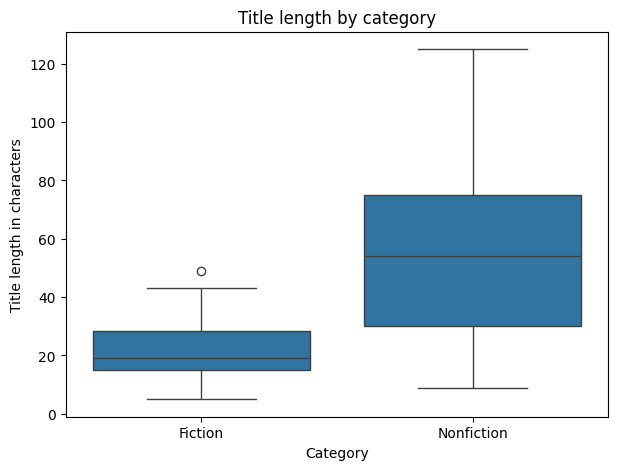

# Book Genre Classifier

Scrapes books from [Books to Scrape](https://books.toscrape.com), cleans and explores the data, and trains text classifiers to predict whether a book is **Fiction** or **Nonfiction** from its title and description.



## Pipeline

| Notebook | Purpose |
|----------|---------|
| `01_scraping.ipynb` | Scrape titles, descriptions and cover images |
| `02_cleaning.ipynb` | Clean text and remove invalid rows |
| `03_exploratory_data_analysis.ipynb` | Explore class balance, text lengths and covers |
| `04_feature_engineering.ipynb` | Add a combined `title_description` column |
| `05_modeling_(*).ipynb` | Train and compare classifiers on title, description, or both |

## Dataset

173 cleaned books (64 Fiction, 109 Nonfiction) from the Fiction and Nonfiction categories. Raw data is in `data/raw/`, cleaned data in `data/cleaned/`, and covers in `images/`.

## Results

TF-IDF features (unigrams and bigrams, 500 max), stratified 80/20 split (35 test books). Accuracy by input:

| Model | Title | Description | Title + Description |
|-------|------:|------------:|--------------------:|
| Naive Bayes | 0.657 | 0.771 | 0.829 |
| Logistic Regression | 0.657 | 0.657 | 0.714 |
| Random Forest | 0.514 | **0.829** | **0.857** |
| SVM (linear) | 0.657 | 0.800 | 0.829 |

Title plus description works best, with Random Forest reaching 85.7% accuracy (0.838 macro F1). Titles alone are too short to be useful, and most models just predict the majority class.

## Getting Started

```bash
git clone https://github.com/mdjawadulhasan/BookGenreClassifier.git
cd BookGenreClassifier
python3 -m venv .venv
source .venv/bin/activate
pip install -r requirements.txt
```

Run the notebooks in order. The cleaned data and images are already included, so you can skip scraping. On macOS, `Open Project.command` opens the project in a preconfigured VS Code window.

> **Note:** Notebooks 01 and 03 use paths relative to the project root, while 02, 04 and 05 use `../data/...`. Adjust the working directory if you get a `FileNotFoundError`.

## Tech Stack

`requests`, `beautifulsoup4`, `pandas`, `matplotlib`, `seaborn`, `pillow`, `scikit-learn`
